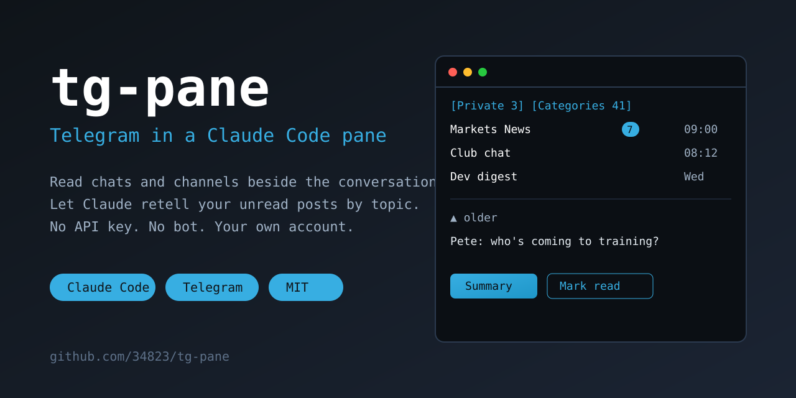

<p align="center">
  
</p>

<p align="center">
  <a href="https://github.com/34823/tg-pane/stargazers"></a>
  <a href="LICENSE"></a>
  <a href="https://github.com/34823/tg-pane/commits/main"></a>
  
  
  
</p>

# tg-pane — Telegram in a Claude Code pane

> Read your Telegram chats and channels beside the conversation, and ask Claude to retell the unread posts by topic.
> No API key, no bot — it works through your own logged-in Telegram Web.

**Quick start** (details in [Install](#install)):

```
/plugin install tg-pane --marketplace 34823/tg-pane
```

Then `/tg-pane`, scan the QR code with your phone — done.

## Features

- **Private** — chats with people, unread first; read a chat without sending «read», reply from the input field.
  The other person sees «read» only when you reply or press **Mark read**. **Summary** retells the unread private
  chats (or one chat) in the conversation — without marking them read.
- **Categories** — **All chats**, then your Telegram folders, with unread counts and a preview. Open one to see its
  chats, open a chat to read it (in a group, with who wrote what), scroll back with the mouse wheel (or **▲ / ▼**); a picture has an **▣ open** row — it is downloaded only then and drawn over the chat inside the pane (✕ closes). **Theme** in the header flips the colour. **Summary** on a folder
  or a chat asks Claude to read the unread posts and retell them by topic, right in the conversation. **Mark all read**
  clears a folder.
- Times on the right, in your time zone: the system's, or — on a server set to UTC — asked once in the pane.
- The pane opens where you left it, after `/clear` and after a restart.
- Login by QR code drawn in the pane; works in a narrow pane too (list, then chat).

```
 [Private 3] [Categories 41] [Refresh]  cache 15:48
 [← Folders] Interesting 34 [Summary] [Mark all read]

  Markets News (7)   09:00   Club chat  [Mark read (2)] [Summary]
  Club chat (2)  08:12   ▲ older
  Markets          Wed   — 8.10 —
  …                      Pete: who's coming to training?    08:12
```

## How it works

There is no Telegram API key and no bot: the mod drives **Telegram Web** (web.telegram.org/k) logged in to your
account, in a headless Chromium on your machine, and reads it through Telegram Web's own internal API — the same
calls its interface makes. Nothing leaves your machine except what Telegram Web itself sends. The browser is
touched only while the pane is open and in use (counters once a minute, the open chat once a minute, a pause after
10 idle minutes and whenever Telegram answers FLOOD_WAIT). Nothing is sent but what you type.

The backend is a few Python scripts in `backend/` (Playwright). They also work on their own:

| Script | What it does |
|---|---|
| `tgbrowser.py start\|stop\|status\|login` | the headless Chromium; `login` prints the QR code in the terminal and asks for the cloud password |
| `tgcache.py [folder…]` | unread counters and previews of your folders into the cache |
| `tgchat.py <peer> [N] [--read] [--before <mid>]` | a chat's history as JSON |
| `tgmsg.py --peer <peer> "<text>"` | send one message, check it went out |
| `tgmedia.py <peer> <mid>` | downloads one message's picture (photo, image, video preview) to the data folder as PNG, only when you press «open» |
| `tgcells.py <png> <cols> <rows>` | turns that picture into terminal cells for the pane (needs Pillow) |
| `tgunread.py "<folder>" \| --peer <id> \| --private [--mark-only]` | unread posts as text for a model; channels and groups are marked read, private chats (and `--private`) never |

## What it runs, reads and sends

The plugin is a pane (`hooks/register.tsx`) plus the Python scripts in `backend/` (Playwright).

- **Runs:** the Python from the **Python** option (default `python3`) with one of the scripts in `backend/`
  (`tgbrowser.py`, `tgcache.py`, `tgchat.py`, `tgmsg.py`, `tgunread.py`) and its arguments; the command is
  `<python> <plugin folder>/backend/<script> <args>`, no shell. `tgbrowser.py` starts a headless Chromium
  (Playwright's, with a debugging port on `127.0.0.1:9444` only) with its own profile in the data folder.
  Nothing else is started.
- **Reads:** Telegram Web (`web.telegram.org/k`) in that browser, logged in to *your* account: folders, unread counters,
  chat history, and the browser profile — which **is** your Telegram session. The pane also reads `HOME` (only to find the
  default data folder) and keeps its cache, lock and `config.json` in the data folder. It does not read your project files.
- **Sends to the network:** only what Telegram Web itself sends to Telegram (reading, and «mark read» when you press it or open a channel with that
  option on), plus a message when you type one in the pane's input field. There is no other server and no analytics.
- **Sends to the conversation (and so to the model):** when you press **Summary**, the pane submits a prompt (`$.prompt.submit`)
  that tells Claude to run `tgunread.py` and retell the result (for a channel or a group that script also marks it read; private chats are never marked read by a summary). The unread posts of that folder or chat then become part of the
  Claude Code conversation and go to the model like any other text there. Press nothing, and nothing is passed on.
- **Hooks:** `session.start` registers the `/tg-pane` command and starts timers that run only while the pane is open;
  `command.run` for `tg-pane` opens the pane; `session.end` / `classic.SessionStart` / `ui.close` reopen or close it after `/clear`;
  `ui.render` draws it. No hook changes a prompt, a tool call, a setting or another plugin's behaviour.

## Install

1. In Claude Code (a terminal session):

   ```
   /plugin install tg-pane --marketplace 34823/tg-pane
   ```

   Answer `y` to add the marketplace, pick a scope, set the options (all have defaults).

2. Python with Playwright and its Chromium (once):

   ```
   python3 -m pip install playwright
   python3 -m playwright install chromium
   ```

   Another Python (a venv) — put its path into the **Python** option (`/config`).

3. `/tg-pane`. The first time it starts the browser and shows a QR code: Telegram on your phone → Settings →
   Devices → Link Desktop Device, and scan it. If the account has a cloud password, the pane shows the command to
   run in a terminal (the password is typed there, never into the pane).

## Options (`/config`)

| Option | Default | |
|---|---|---|
| Python | `python3` | the Python that has Playwright |
| Data folder | `~/.local/share/tg-pane` | browser profile (your Telegram session — keep it private), cache, lock; `config.json` there may set `port` (9444) and `tz` for the scripts run by hand |
| Private chats folder | empty | a Telegram folder for the **Private** tab; empty — every chat with a person or a bot |
| Language | `en` | `en` or `ru`, the pane and summaries |
| Mark channels read on open | on | as Telegram does; private chats and groups are never marked read by just looking |
| Time zone | system | IANA name for message times; empty and the system is on UTC — the pane asks once |

## Caveats

- Unofficial: Telegram Web's internal API can change with its updates; then a script fails and the pane shows the error.
- The browser profile in the data folder **is** a logged-in session of your account. Do not copy or share it.
  To log out: Telegram → Settings → Devices → end the «Telegram Web» session, or delete the folder.
- Linux and macOS. On a server run as root, Chromium starts with `--no-sandbox`.

## Develop

```
claude plugin validate .
claude plugin test .
claude --plugin-dir .
```

## Feedback

If it is useful, a ⭐ on the repo helps others find it ([contributing](CONTRIBUTING.md), [security](SECURITY.md)). Ideas and questions — [Discussions](https://github.com/34823/tg-pane/discussions); bugs — [Issues](https://github.com/34823/tg-pane/issues) (a 👍 on an issue shows what matters most).

MIT license.

## Star history

[](https://star-history.com/#34823/tg-pane&Date)
